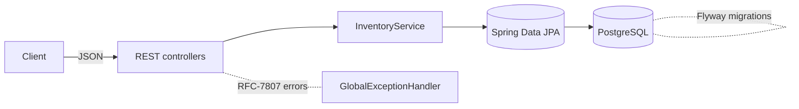

# inventory-service — Spring Boot stock reservations

> A production-shaped **Java 21 / Spring Boot** service for product stock and
> **concurrency-safe reservations**. The interesting part isn't CRUD — it's that
> concurrent reservers can never oversell, and retried requests never hold stock
> twice.


> ℹ️ An **original reference implementation** built to demonstrate senior backend
> practices in Java/Spring. No proprietary code, data, or confidential
> information is included.

---

## Why this exists

Stock reservation is a classic correctness trap. The naive approach —

```text
read available  →  check in Java  →  write available - qty
```

— races: two requests both read "1 left", both pass the check, both write, and
you've sold the same unit twice. This service is built around **not** doing that.

---

## How it stays correct

**1. Guarded atomic decrement (no overselling).**
Reserving stock is a single conditional SQL update, not a read-modify-write:

```sql
update products
   set quantity_available = quantity_available - :qty,
       quantity_reserved  = quantity_reserved  + :qty
 where id = :id
   and quantity_available >= :qty      -- the guard
```

The database serializes concurrent updates to the row, and the `>= :qty` guard
means only the callers that actually have stock succeed. The update returns the
number of affected rows: `1` = reserved, `0` = insufficient stock. No
application locks, no retry loop, no oversell. See
[`ProductRepository.reserveStock`](src/main/java/com/kratos0722/inventory/repository/ProductRepository.java).

**2. Idempotency key (no double-holding on retries).**
Every reservation carries a unique `idempotencyKey`. Replaying a request —
client retry, at-least-once queue, double-click — returns the *original*
reservation instead of holding stock again. See
[`InventoryService.reserve`](src/main/java/com/kratos0722/inventory/service/InventoryService.java).

**3. Optimistic locking for everything else.**
`Product` carries a JPA `@Version`, so non-reservation updates fail fast on
concurrent modification rather than silently clobbering.

A reservation then moves through a small lifecycle:

```text
RESERVED ──confirm──▶ CONFIRMED   (stock consumed / shipped)
   │
   └────release────▶ RELEASED     (stock returned to available)
```

---

## Architecture



- **Web** — thin controllers + DTO records; a `@RestControllerAdvice` maps domain
  and validation errors to RFC-7807 `application/problem+json`.
- **Service** — transactions and all business rules; the concurrency logic lives here.
- **Persistence** — Spring Data JPA / Hibernate over PostgreSQL; **Flyway** owns
  the schema (`ddl-auto=none` in production).

## Tech stack

- **Java 21**, **Spring Boot 4** (Web MVC, Data JPA, Validation, Actuator)
- **PostgreSQL 16** + **Flyway** migrations (H2 for the test suite)
- **JUnit 5**, `@SpringBootTest` / `@DataJpaTest`, MockMvc
- **Docker** multi-stage build + **docker-compose**; **GitHub Actions** CI

---

## API

| Method | Path | Purpose |
| --- | --- | --- |
| `POST` | `/api/v1/products` | Create a product → `201` |
| `GET`  | `/api/v1/products/{sku}` | Fetch a product |
| `GET`  | `/api/v1/products` | List products |
| `POST` | `/api/v1/reservations` | Reserve stock (idempotent) → `201` / `409` |
| `GET`  | `/api/v1/reservations/{id}` | Fetch a reservation |
| `POST` | `/api/v1/reservations/{id}/confirm` | Consume reserved stock |
| `POST` | `/api/v1/reservations/{id}/release` | Return reserved stock |

Reserve request:
```json
{ "idempotencyKey": "order-42", "sku": "WIDGET-1", "quantity": 3 }
```
Insufficient stock responds `409` with a problem document:
```json
{ "title": "Insufficient stock", "status": 409,
  "detail": "Insufficient stock for SKU 'WIDGET-1' to reserve 3 unit(s)" }
```

---

## Run it

### Docker Compose (app + Postgres)
```bash
docker compose up --build
# API:    http://localhost:8080/api/v1/products
# Health: http://localhost:8080/actuator/health
```

### Locally against Postgres
```bash
export DB_URL=jdbc:postgresql://localhost:5432/inventory
export DB_USERNAME=inventory DB_PASSWORD=inventory
./mvnw spring-boot:run
```

## Tests

```bash
./mvnw verify
```
The suite runs on in-memory H2 (no Docker needed) and covers:

- **Service rules** — create/duplicate, reserve, insufficient stock, idempotent
  replay, confirm/release, illegal transitions.
- **Persistence** — the guarded atomic `reserveStock` update.
- **API** — status codes, round-trips, `problem+json`, validation `400`s.
- **Concurrency** — 200 threads race for 50 units; the test asserts **exactly 50**
  reservations succeed, the rest get `409`, and stock is fully conserved
  ([`ReservationConcurrencyTest`](src/test/java/com/kratos0722/inventory/service/ReservationConcurrencyTest.java)).

---

## Design decisions & trade-offs

- **Guarded SQL update over `SELECT … FOR UPDATE` or retry loops** — one round
  trip, no lock held across application code, and it reads as plainly correct.
- **Flyway owns the schema; Hibernate only validates nothing (`ddl-auto=none`)** —
  migrations are reviewable and deterministic across environments.
- **Idempotency at the domain level** — safe under at-least-once delivery, not
  just HTTP retries.
- **H2 for tests, PostgreSQL for real** — fast, hermetic CI without sacrificing a
  production-accurate local/compose setup.

---

*An original reference implementation. No proprietary code, data, or confidential information is included.*
